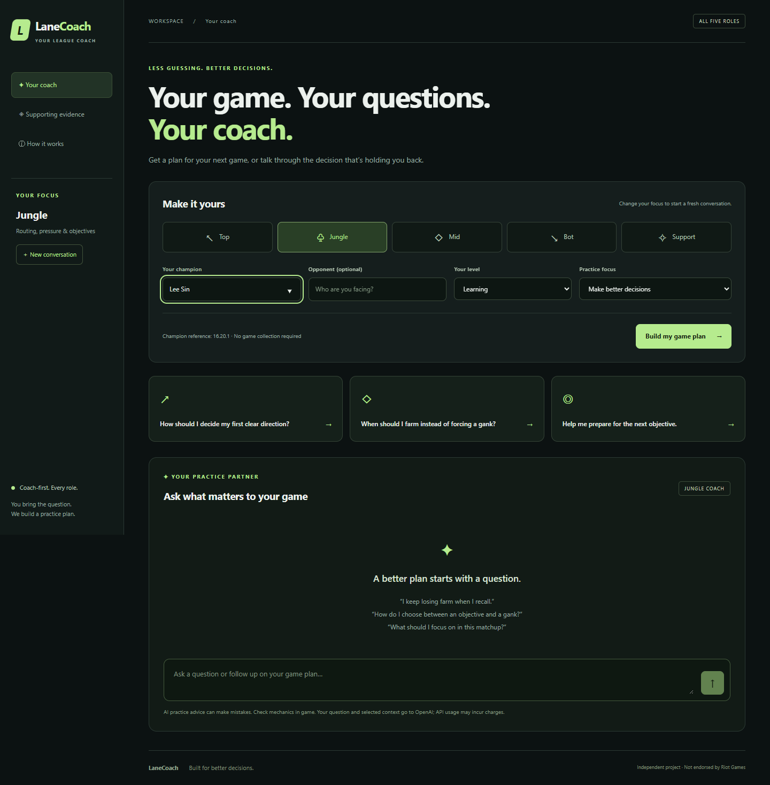
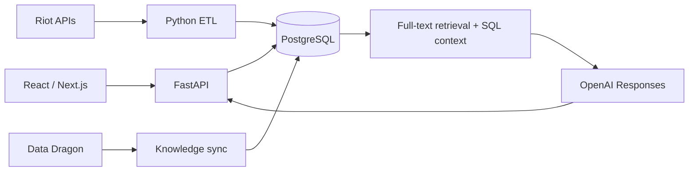

# LaneCoach

A League of Legends practice coach for **Top, Jungle, Mid, Bot, and Support**. Ask questions, build pre-game guides, and follow up in saved conversations. Collecting a player's games is optional background work.

**React / Next.js · FastAPI · PostgreSQL · Python ETL · OpenAI Responses API**



Local coaching workspace. Generated advice is shown separately from measured match evidence.

## Features

- Coaching adapted to role, champion, opponent, experience, and practice focus.
- Retrieval of authored role guidance and Riot Data Dragon champion references, with sources shown alongside answers.
- Persistent multi-turn conversations and contextual follow-ups.
- Optional Account-V1 / Match-V5 ETL for Ranked Solo/Duo (`queueId=420`), extracting all five roles, runes, items, KDA, CS, gold, patch, and opponents. Transactional duplicate prevention and bounded rate-limit retries.
- SQL analytics for observed game win rates, sample sizes, rune associations, and opponent performance, filtered by role, matchup, and patch.

## Docker quickstart

Install and start Docker Desktop with Linux containers. From the repository root:

```powershell
# Only copy this if backend/.env does not already exist.
Copy-Item backend/.env.example backend/.env
# Edit backend/.env privately. Never paste keys into GitHub or terminal commands.
docker compose up --build -d
docker compose exec api python -m backend.platform.sync --champions Garen Darius LeeSin Leona
```

Open **http://localhost:3000**. API documentation: **http://localhost:8000/docs**. Set `OPENAI_API_KEY` for AI answers and `RIOT_API_KEY` for optional ingestion. Public knowledge sync needs no Riot key. API usage incurs charges; ChatGPT subscriptions do not include API credits.

`docker compose down` preserves database data. Ports bind to localhost. The default database password is for local development; override `POSTGRES_PASSWORD` elsewhere. There is no public authentication or paid-API abuse boundary yet; do not expose coaching endpoints publicly.

## Local development with the existing virtual environment

Run PostgreSQL, then start FastAPI and Next.js in separate terminals:

```powershell
docker compose up -d db
.\backend\venv\Scripts\python.exe -m pip install -r backend/requirements-dev.txt
.\backend\venv\Scripts\python.exe -m backend.platform.sync --champions Garen Darius
.\start.ps1
```

```powershell
cd web
npm ci
npm run dev
```

Set `DATABASE_URL` in `backend/.env` for another PostgreSQL instance. Its default matches Compose. `OPENAI_MODEL` defaults to `gpt-4.1-mini`. Next.js proxies `/api` to FastAPI; `API_ORIGIN` overrides that destination for development/builds.

## Optional ETL

For migration history, bounded account discovery, coverage reports, full champion-reference sync, and verified local backups, see [PostgreSQL data and operations](docs/database-operations.md).

Riot match discovery needs seed accounts, but the coach does not require personal match collection. Create the ignored `backend/etl-seeds.json` locally:

```json
[{"game_name": "YourRiotName", "tag": "YourTag", "region": "americas"}]
```

```powershell
.\backend\venv\Scripts\python.exe -m backend.platform.etl --seed-file backend/etl-seeds.json --count 100
# Optional hourly refresh; Ctrl+C stops the process.
.\backend\venv\Scripts\python.exe -m backend.platform.etl --seed-file backend/etl-seeds.json --count 100 --interval 3600
```

Inside Docker, copy your private seed file into the running container (it is excluded from the image):

```powershell
docker compose cp backend/etl-seeds.json api:/tmp/etl-seeds.json
docker compose exec api python -m backend.platform.etl --seed-file /tmp/etl-seeds.json --count 100
```

Regions: `americas`, `europe`, `asia`, `sea`. Development Riot keys expire; replace them privately. Raw matches and normalized role rows are stored in PostgreSQL. Riot player identifiers are not sent to OpenAI.

Example analytics request:

```text
http://localhost:8000/api/analytics?champion=Garen&role=TOP&opponent=Darius&patch=16.20
```

## Architecture and evidence



Current code lives in `web/` and `backend/platform/`. RAG uses PostgreSQL full-text search with a GIN index and role/champion filters, not embeddings. Sources distinguish authored practice guidance from patch-tagged champion references. Retrieved context is not proof of every generated claim.

Statistics measure **observed game wins, not lane wins**. Seed selection, rank, patch, mastery, and small samples affect results. Rune associations do not establish optimal runes; opponent performance does not establish universal counters. Zero samples display no win rate. Jungle routes are conditional generated advice, not measured path telemetry; v2 does not ingest timelines.

Original Flask/SQLite tools remain available with a separate database. Top-only records are not silently converted into all-role records. See [legacy usage](docs/legacy.md).

## Verification

```powershell
.\backend\venv\Scripts\python.exe -m unittest discover -s backend/tests -v
cd web
npm run typecheck
npm run build
```

Offline tests use isolated synthetic fixtures. Native PostgreSQL integration requires `TEST_DATABASE_URL` pointing to a dedicated test database; otherwise it is explicitly skipped. GitHub Actions provisions PostgreSQL and builds Next.js without API keys. See [verification instructions](docs/verification.md).

## Portfolio

See [publication notes and remaining work](docs/publication-notes.md), including PostgreSQL data coverage, coaching knowledge, database operations, and public-demo requirements.

See [résumé implementation audit](docs/resume.md) for accurate wording. Source publication and a hosted demo are separate steps. No scale, reliability, path extraction, or deployment claim is implied. Secrets, databases, environments, private seeds, and generated artifacts are ignored.

League of Legends assets belong to Riot Games. LaneCoach is an independent portfolio project.
